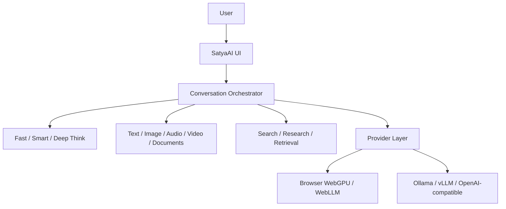

# SatyaAI

Truth-first intelligence for reasoning, research, and creation.

### [Open SatyaAI →](https://satyaai-five.vercel.app)

SatyaAI V0.1 is a privacy-conscious, local-first interface foundation. It exposes Fast, Smart, and Deep Think modes without coupling the UI to a model vendor. The default build is honest about capability: without a configured inference endpoint, it provides the complete interaction shell and clearly labelled degraded state rather than fabricating model output, citations, or search results.

## Run locally

```bash
pnpm install
pnpm dev
```

Optional compatible endpoints can be configured with `.env.example`. No paid API is required for the default boot path.

## Architecture



## Honest V0.1 boundaries

The interface and boundaries are ready for provider, persistence, document, and research adapters. Live model inference, SearXNG search, citation-backed research, IndexedDB history, audio transcription, and video keyframe extraction require the next implementation phase and optional infrastructure. The current hosted build does not claim those capabilities.

See [`docs/architecture.md`](docs/architecture.md), [`docs/privacy-model.md`](docs/privacy-model.md), and [`docs/future-training.md`](docs/future-training.md).


## SATYA CORE

SATYA CORE is SatyaAI's versioned, application-level source of truth for product identity, founder and contributor records, documented origin, philosophy, capability status, personality, and behavioural rules. It is separate from each user's editable profile memory and from dynamic inference metadata.

The shared core is used by browser-local inference, user-configured compatible endpoints, and the Vercel remote gateway. The gateway constructs its system context on the server and discards browser-supplied system messages.

See [docs/satya-core.md](docs/satya-core.md) for architecture, current status, privacy boundaries, and maintenance instructions.
