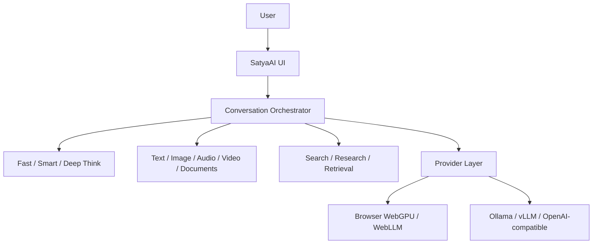

# SatyaAI

Truth-first intelligence for reasoning, research, and creation.

### [Open SatyaAI →](https://satyaai.vercel.app)

SatyaAI V0.1 is a privacy-conscious, local-first interface foundation. It exposes Fast, Smart, and Deep Think modes without coupling the UI to a model vendor. The default build is honest about capability: without a configured inference endpoint, it provides the complete interaction shell and clearly labelled degraded state rather than fabricating model output, citations, or search results.

## Run locally

```bash
pnpm install
pnpm dev
```

Optional compatible endpoints can be configured with `.env.example`. No paid API is required for the default boot path.

## Architecture



## Honest V0.1 boundaries

The interface and boundaries are ready for provider, persistence, document, and research adapters. Live model inference, SearXNG search, citation-backed research, IndexedDB history, audio transcription, and video keyframe extraction require the next implementation phase and optional infrastructure. The current hosted build does not claim those capabilities.

See [`docs/architecture.md`](docs/architecture.md), [`docs/privacy-model.md`](docs/privacy-model.md), and [`docs/future-training.md`](docs/future-training.md).
