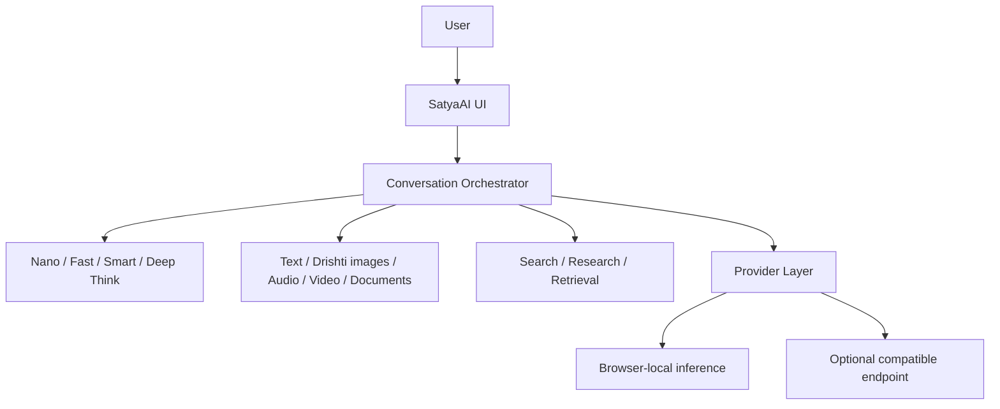

# SatyaAI

Truth-first intelligence for reasoning, research, and creation.

### [Open SatyaAI →](https://satyaai-five.vercel.app)

## Product engine

**SatyaSom Engine** is SatyaAI's product identity and original application-level architecture for conversation flow, local inference orchestration, memory, and creative workspaces. The four user-facing tiers are Anu (Nano), Indu (Fast), Dhara (Smart), and Aditya (Deep Think). The current tiers run locally in the browser through WebGPU; model files are downloaded to the device and reused from its cache. A compatible remote endpoint is optional and is used only when a user configures one.

## Required model attribution

**Built with Llama.** The current Fast, Smart, and Deep text tiers use Llama 3.2 model weights. This exact attribution is retained in product documentation to comply with the model licence; it does not replace SatyaSom Engine as the product identity. See the [Llama 3.2 Community License](https://dev.meta.ai/llama/llama3_2/license) and [model notices](docs/model-notices.md).

SatyaAI V0.1 is a privacy-conscious, local-first AI application. SatyaSom Engine is the application-level architecture; each tier selects its own local model configuration and generation settings. All four tiers run locally in the browser through WebGPU. Model weights download to the device once and are reused from the browser cache. No hosted API key or paid inference provider is required. An optional compatible endpoint can be configured in Settings when a user deliberately wants remote inference. A supported WebGPU browser and compatible hardware are required for local inference.

## Run locally

```bash
pnpm install
pnpm dev
```

All four tiers run locally by default and do not require Vercel inference secrets. Users may optionally configure a compatible endpoint under Settings → Models & inference. Keep endpoint credentials out of source control. See [docs/hosting.md](docs/hosting.md).

## Architecture



## Honest V0.1 boundaries

Browser-local text inference is implemented when the browser and device support WebGPU. All tiers are on-device by default. Engine identity and reasoning-mode labels are application-owned; low-level implementation identifiers are kept separate from the user-facing product identity. The Drishti Image and Chakshu Video workspaces use a loopback-only local Diffusers runtime. Install the Windows companion once; it manages its own private Python environment, starts automatically when needed, and downloads only the selected model on first use. Video model eligibility is checked against current GPU memory, available RAM and disk. Vercel hosts the UI, not image or video inference. Web search, SearXNG integration, citation-backed research, audio transcription, video keyframe extraction, and general multimodal document understanding remain separate capabilities that require additional implementation.

See [`docs/architecture.md`](docs/architecture.md), [`docs/privacy-model.md`](docs/privacy-model.md), and [`docs/future-training.md`](docs/future-training.md).


## Drishti local image runtime

See [`runtime/README.md`](runtime/README.md) for Windows setup. The companion runs on `127.0.0.1:7860`, loads only the selected model and keeps model downloads in the local Hugging Face cache. Image and video prompts go directly to that local service, never through the SatyaSom chat pipeline. Model licenses and hardware requirements are tier-specific. The Chakshu family uses Wan2.1 1.3B (Chakshu Lite), Wan2.2 TI2V-5B (Chakshu 1.0), and LTX-2.5 22B (Divya Chakshu 1, Experimental); LTX-2.5 weights use a separate community licence and require explicit acknowledgement.

## SATYA CORE

SATYA CORE is SatyaAI's versioned, application-level source of truth for product identity, founder and contributor records, documented origin, philosophy, capability status, personality, and behavioural rules. It is separate from each user's editable profile memory and from dynamic inference metadata.

The shared core is used by browser-local inference, user-configured compatible endpoints, and the Vercel remote gateway. The gateway constructs its system context on the server and discards browser-supplied system messages.

During response generation, all model modes share a rotating set of 30 English-first Hinglish status lines. They are shuffled without immediate repeats and remain separate from model-download progress. Browser-local model loading has separate stage-specific message pools for cache checks, downloads, slow waits, progress, cache retrieval, initialization, model switching, recovery, and readiness.

See [docs/satya-core.md](docs/satya-core.md) for architecture, current status, privacy boundaries, and maintenance instructions.
